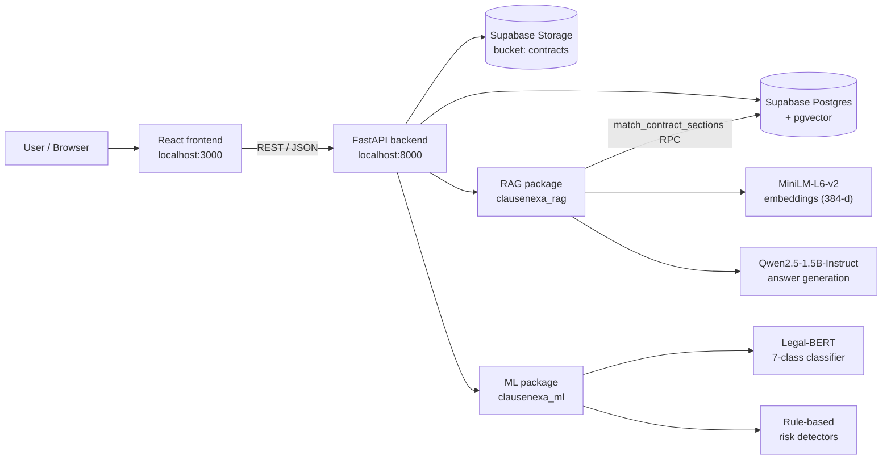
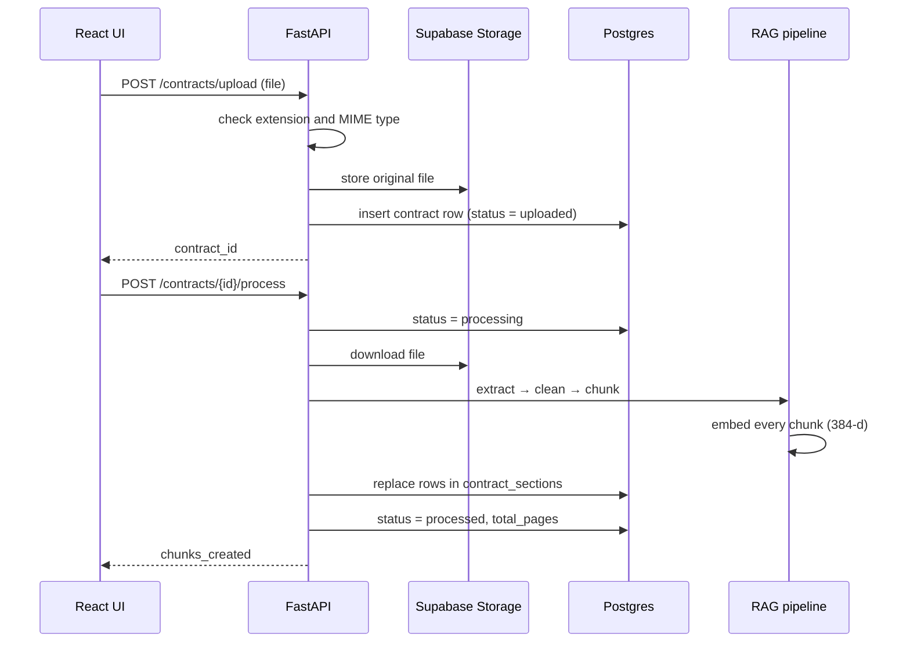

# ClauseNexa

**Legal contract analysis and risk detection using NLP, retrieval-augmented generation (RAG) and a local LLM.**

ClauseNexa lets a user upload a contract (PDF or Word). The system then:

1. **Extracts and chunks** the contract text and stores it, with vector embeddings, in a Postgres database.
2. **Classifies every clause** with a fine-tuned Legal-BERT model into one of seven classes: Confidentiality, Governing Law, Liability, Non-Compete, Payment, Termination, or Other.
3. **Flags risky clauses** (Low / Medium / High) with explainable, rule-based risk detectors.
4. **Answers questions** about the contract in plain English, grounded only in the contract text, and shows the exact source passages used.

> ClauseNexa is a decision-support prototype. Risk levels are automated attention indicators, **not legal advice**.

---

## Table of contents

1. [Features](#1-features)
2. [Tech stack](#2-tech-stack)
3. [System architecture](#3-system-architecture)
4. [Data flow](#4-data-flow)
5. [Repository structure](#5-repository-structure)
6. [Component details](#6-component-details)
   - [6.1 Frontend (React)](#61-frontend-react)
   - [6.2 Backend (FastAPI)](#62-backend-fastapi)
   - [6.3 RAG pipeline](#63-rag-pipeline-rag)
   - [6.4 ML / NLP layer](#64-ml--nlp-layer-ml)
   - [6.5 Database (Supabase)](#65-database-supabase)
   - [6.6 Data](#66-data-data)
   - [6.7 Tests and evaluation](#67-tests-and-evaluation-tests)
7. [API reference](#7-api-reference)
8. [Setup and running locally](#8-setup-and-running-locally)
9. [Results](#9-results)
10. [Scope and constraints](#10-scope-and-constraints)
11. [Known limitations and future work](#11-known-limitations-and-future-work)
12. [Team and contributions](#12-team-and-contributions)
13. [Project timeline](#13-project-timeline)
14. [Further documentation](#14-further-documentation)

---

## 1. Features

| Feature | What the user sees | How it works |
|---|---|---|
| Contract upload | Upload a `.pdf` or `.docx` file and see a list of all uploaded contracts | FastAPI validates the file, stores it in Supabase Storage and records it in Postgres |
| Processing | The contract moves from `uploaded` → `processing` → `processed` | Text extraction, cleaning, clause-aware chunking and 384-dimension embeddings |
| Contract overview | Overall risk, clause count, High / Medium counts, clauses needing review, missing categories | Summary produced by the ML layer |
| Clause analysis | A card per clause with its category, risk badge and reasons | Legal-BERT classification + rule-based risk detectors |
| Ask the contract | A chat where answers cite expandable source passages | Hybrid retrieval (pgvector + keywords) + Qwen2.5-1.5B-Instruct running locally |
| Off-topic refusal | Questions the contract cannot answer are refused, not invented | Relevance gate + strict grounding prompt |
| Delete | Remove a contract and all its data | Deletes the stored file and cascades through every database table |

---

## 2. Tech stack

| Layer | Technology |
|---|---|
| Frontend | React 19, React Router 7, lucide-react icons, Create React App (`react-scripts`) |
| Backend | Python 3.10+, FastAPI, Uvicorn, Pydantic, `supabase-py`, `python-dotenv` |
| Database and storage | Supabase (Postgres with the `pgvector` extension, Supabase Storage) |
| Document parsing | `pypdf` (PDF), `python-docx` (Word) |
| Embeddings | `sentence-transformers/all-MiniLM-L6-v2` (384 dimensions, runs locally) |
| Answer generation (LLM) | `Qwen/Qwen2.5-1.5B-Instruct` via Hugging Face `transformers` (runs locally, GPU if available) |
| Clause classifier | `nlpaueb/legal-bert-base-uncased`, fine-tuned for 7 classes on the LEDGAR dataset |
| Baseline classifier | TF-IDF + Logistic Regression (scikit-learn) |
| Model training | Google Colab (T4 GPU), Hugging Face `Trainer` |
| Testing | Python test scripts, a custom evaluation harness, React Testing Library (Jest) |
| Dev tooling | Git and GitHub (feature branches + pull requests), `concurrently` to run both servers |

No paid API is needed: every model runs on the local machine.

---

## 3. System architecture



The project is split into four parts that each team member owned:

| Part | Folder | Role |
|---|---|---|
| Frontend | `frontend/` | The web interface (4 pages) |
| Backend | `backend/` | REST API that connects everything and talks to Supabase |
| RAG | `rag/` | Turns documents into searchable chunks and answers questions |
| ML / NLP | `ml/` | Splits a contract into clauses, classifies them and scores risk |

`rag/` and `ml/` are installable Python packages (`clausenexa_rag`, `clausenexa_ml`). The backend installs both in editable mode, so each team could develop its package independently.

When the backend starts, a background thread preloads all three models (embeddings, Legal-BERT, Qwen). The API accepts requests while they load. If a model is missing, only the endpoint that needs it returns `503`; the rest of the app keeps working.

---

## 4. Data flow

### 4.1 Upload and processing



If the database insert fails after the file was stored, the backend deletes the stored file so no orphaned files are left. If processing fails, the contract is marked `failed`.

### 4.2 Clause analysis

```
contract_sections (text)  →  split_contract_text()   one item per clause
                          →  Legal-BERT (7 classes)  category + confidence
                          →  confidence < 0.70     → "Needs Review" (no risk rules)
                          →  category = Other      → "Not Applicable"
                          →  detect_risk()           risk level + score + reasons
                          →  contract-wide check     e.g. confidentiality exclusions in another clause
                          →  JSON report             { summary, clauses, disclaimer }
```

### 4.3 Asking a question (RAG)

```
question  →  embed question (MiniLM, 384-d)
          →  pgvector search: top max(2·k, 10) chunks of this contract (cosine similarity)
          →  re-rank: hybrid score = similarity + 0.5 × keyword overlap
          →  relevance gate: best hybrid score < 0.2  →  "I could not find relevant information"
          →  prompt Qwen2.5-1.5B with ONLY the top-k chunks (greedy decoding, 240 tokens max)
          →  remove any "Clause X.Y" reference that is not in the retrieved text
          →  return { answer, sources[ chunk, page, similarity, full text ] }
```

---

## 5. Repository structure

```
ClauseNexa/
├── README.md                     ← this file
├── package.json                  ← root scripts: run backend + frontend together
├── requirements.txt              ← (empty; dependencies live in backend/requirements.txt)
├── .gitignore                    ← ignores .env, venvs, node_modules, large models and datasets
│
├── frontend/                     ← React web app
│   ├── package.json
│   ├── public/                   ← index.html, favicon, manifest
│   └── src/
│       ├── App.js                ← routes and top navigation bar
│       ├── api.js                ← every call to the backend
│       ├── ContractContext.js    ← selected contract + cached analysis (shared state)
│       ├── App.live.test.js      ← end-to-end UI test against the real backend
│       └── pages/
│           ├── UploadContract.jsx / .css    ← upload, list, open, delete
│           ├── ContractOverview.jsx / .css  ← risk summary dashboard
│           ├── ClauseAnalysis.jsx / .css    ← per-clause cards
│           └── AskContract.jsx / .css       ← chat with source passages
│
├── backend/                      ← FastAPI service
│   ├── requirements.txt          ← also installs ../rag and ../ml in editable mode
│   ├── BACKEND_OVERVIEW.md       ← backend design notes
│   ├── test_database.py          ← manual Supabase connection check
│   ├── match_contract_sections.py← manual retrieval check (hard-coded contract id)
│   └── app/
│       ├── main.py               ← app, CORS, /health, model preloading
│       ├── database.py           ← Supabase client (reads .env)
│       ├── models/contract.py    ← Pydantic request / response models
│       ├── routes/contracts.py   ← all /contracts endpoints
│       └── services/
│           ├── storage.py        ← upload / download files in Supabase Storage
│           └── rag_service.py    ← processing pipeline: download → chunk → embed → store
│
├── rag/                          ← RAG package (clausenexa_rag)
│   ├── pyproject.toml
│   └── src/clausenexa_rag/
│       ├── extractor.py          ← PDF / DOCX → text with [PAGE n] markers
│       ├── cleaner.py            ← Unicode and whitespace normalisation
│       ├── chunker.py            ← clause-aware chunks (≤ 1,800 chars, 1-unit overlap)
│       ├── pipeline.py           ← extract → clean → chunk
│       ├── embeddings.py         ← MiniLM-L6-v2, 384-d, normalised
│       ├── retriever.py          ← pgvector search + keyword re-rank (hybrid)
│       ├── generator.py          ← Qwen2.5-1.5B-Instruct with a grounding prompt
│       └── rag.py                ← ask_contract(): retrieve → gate → generate → sources
│
├── ml/                           ← ML / NLP package (clausenexa_ml)
│   ├── pyproject.toml
│   ├── src/clausenexa_ml/
│   │   ├── clause_splitter.py    ← contract text → list of clauses
│   │   ├── classifier.py         ← Legal-BERT inference (loaded once, batched)
│   │   ├── risk_detector.py      ← 6 rule-based risk detectors
│   │   └── contract_analyzer.py  ← analyze_contract(): full report + summary
│   ├── scripts/                  ← reproducible training pipeline (01 → 05) + paths.py
│   ├── notebooks/
│   │   ├── train_legalbert_7class_colab.ipynb  ← training run with saved outputs
│   │   └── risk_detection.py     ← experiment file (kept in sync with the package)
│   └── models/logistic_regression/             ← TF-IDF + LogReg baseline (.joblib)
│
├── supabase/
│   ├── schema.sql                ← 7 tables, indexes, row-level security
│   └── migrations/               ← 001 → 004 (page numbers, embeddings, 384-d, vector search)
│
├── data/
│   ├── raw/                      ← ClauseNexa_ML_Dataset.csv (old V1 dataset, unused)
│   ├── processed/                ← LEDGAR label list, LogReg error analysis
│   └── sample_contracts/         ← sample_contract.pdf (fictional 5-page services agreement)
│
├── tests/
│   ├── test_risk_detector.py     ← 22 regression tests for the risk rules
│   └── eval/
│       ├── run_eval.py           ← full evaluation harness
│       ├── make_contracts.py     ← builds the DOCX test contracts
│       ├── contracts/            ← 4 fictional contracts (services, NDA, employment, lease)
│       ├── qa_set.json           ← 46 labelled questions
│       ├── risk_set.json         ← 72 hand-labelled clauses
│       └── results.json          ← raw output of the last run
│
└── docs/
    ├── ML_HANDOFF.md             ← ML layer: data, training, results, open work
    ├── TESTING.md                ← test plan, results, defects found
    └── EVALUATION.md             ← auto-generated metrics report
```

---

## 6. Component details

### 6.1 Frontend (React)

A single-page app with a top navigation bar and four pages. The selected contract is kept in a React context, so every page works on the same contract. Clause analysis is expensive, so its result is cached per contract and shared by the Overview and Clause Analysis pages.

| Page | Route | What it does |
|---|---|---|
| Upload Contract | `/` | Choose a PDF/DOCX, upload and process it in one click, then open the Overview. Lists all uploaded contracts with status and date, with **Open** and **Delete** buttons |
| Overview | `/overview` | Status, total pages, upload time; then overall risk, total clauses, High and Medium counts, clauses needing review, and categories not found in the contract |
| Clause Analysis | `/analysis` | One card per clause: predicted category, colour-coded risk badge, the clause text and the reasons for the risk level |
| Ask Contract | `/ask` | Chat interface. Each answer lists its sources (chunk number, page, % match) and each source expands to show the exact contract text |

The backend URL is `http://localhost:8000` by default and can be changed with `REACT_APP_API_URL`.

### 6.2 Backend (FastAPI)

- **`main.py`**: creates the app, enables CORS for `http://localhost:3000`, exposes `/` and `/health`, and preloads the models in a background thread. Set `PRELOAD_MODELS=false` to skip preloading.
- **`database.py`**: one shared Supabase client built from `SUPABASE_URL` and `SUPABASE_SECRET_KEY`. It uses the service-role key because the backend is the only component that talks to Supabase; the browser never does.
- **`routes/contracts.py`**: all contract endpoints (see [API reference](#7-api-reference)).
  - Upload checks both the file extension and the MIME type.
  - The ML and RAG packages are imported inside their endpoints, so the backend still starts if their heavy dependencies (PyTorch, transformers) are missing.
- **`services/storage.py`**: stores files as `contracts/<contract_id>/<random-uuid>.<ext>` with `upsert` off, so files are never silently overwritten.
- **`services/rag_service.py`**: runs the processing pipeline. Processing again replaces the old chunks, so it is safe to repeat.

### 6.3 RAG pipeline (`rag/`)

| Step | File | Details |
|---|---|---|
| Extract | `extractor.py` | PDF: text per page with `[PAGE n]` markers and a page count. DOCX: paragraphs and table rows (no page numbers, since Word does not store them) |
| Clean | `cleaner.py` | NFKC Unicode normalisation, line endings, removes null/form-feed/non-breaking-space characters, collapses spaces and blank lines |
| Chunk | `chunker.py` | Splits on clause numbers (`1.`, `2.3`, `A1.`) and ALL-CAPS headings, tracks the pages each unit covers, packs units into chunks of at most 1,800 characters with a one-clause overlap, and splits very long clauses on word boundaries |
| Embed | `embeddings.py` | `all-MiniLM-L6-v2`, normalised 384-d vectors, runs locally with no API key |
| Retrieve | `retriever.py` | Calls the `match_contract_sections` SQL function (cosine distance in pgvector), then re-ranks with a keyword score (stop words removed, crude stemming). The hybrid score fixed cases where a short clause such as Governing Law was ranked outside the top 5 by vectors alone |
| Generate | `generator.py` | `Qwen2.5-1.5B-Instruct`, greedy decoding, up to 240 new tokens. The system prompt forbids outside knowledge and asks for every condition when a question asks for several |
| Orchestrate | `rag.py` | Relevance gate (minimum hybrid score 0.2), builds the context, generates the answer, removes clause numbers that are not in the context, and returns the sources with their full text |

### 6.4 ML / NLP layer (`ml/`)

**Clause splitting** (`clause_splitter.py`): a new clause starts at `1.`, `1)`, `2.3.4`, `Section 4`, `Clause 7`, `Article IV` or a short ALL-CAPS heading. Sub-items such as `(a)` stay with their parent clause. Page markers and footers are removed, and fragments shorter than 40 characters are merged into the next clause.

**Classification** (`classifier.py`): Legal-BERT fine-tuned for 7 classes with `max_length=384`. It is loaded once, runs in batches of 16, and uses the GPU when available. The model path can be overridden with `CLAUSENEXA_MODEL_DIR`.

**Decision logic** (`contract_analyzer.py`):
- Confidence below **0.70** → `Needs Review`, and no risk rules run.
- Category `Other` → `Not Applicable` (for example Notices, Assignment, Force Majeure).
- Otherwise the category's risk detector runs.
- A contract-wide pass removes the "no confidentiality exclusions" finding if the exclusions appear in a different clause.
- The summary reports the overall (highest) risk, counts by level and category, clauses needing review, missing categories, and the clause numbers rated High.

**Risk rules** (`risk_detector.py`): each detector adds points for every warning sign it finds and records a readable reason. Score 0 = Low, 1–2 = Medium, 3 or more = High (Liability needs 4 or more for High).

| Category | Indicators (points) |
|---|---|
| Non-Compete | duration ≥ 3 years (+2) or 1–2 years (+1); very broad geography (+2); broad activity restriction (+1) |
| Liability | unlimited / uncapped (+3); consequential or punitive damages (+2); indemnity (+1); cap present (−1) |
| Termination | without notice / immediately (+2); notice ≤ 7 days (+2) or 8–30 days (+1); for convenience (+1); one-sided (+1) |
| Payment | due within ≤ 7 days (+2) or 8–14 days (+1); late fee / penalty interest (+1); interest ≥ 15% (+2) or 10–14.99% (+1); unilateral fee changes (+1) |
| Confidentiality | indefinite / perpetual (+2); ≥ 5 years (+2) or 2–4 years (+1); very broad definition (+1); no standard exclusions (+1) |
| Governing Law | foreign (non-Australian) law (+2); exclusive jurisdiction (+1); arbitration abroad (+1); Australian / NSW law (−1) |

**Training pipeline** (`ml/scripts/`, all paths defined in `paths.py`):

| Script | Purpose |
|---|---|
| `01_build_ledgar_dataset.py` | Maps LEDGAR labels onto the 6 categories (846,274 provisions → 42,681 clauses) |
| `02_clean_single_label.py` | Removes 161 clauses that map to two categories (322 rows) → 42,359 clauses |
| `03_train_logistic_regression.py` | TF-IDF + Logistic Regression baseline, split by source contract, 5-fold grouped CV |
| `04_train_legalbert.py` | 6-class Legal-BERT fine-tuning (70/15/15 split by contract) |
| `05_build_7class_dataset.py` | Adds 9,000 curated "Other" clauses from 20 label groups → 51,359 clauses |

The final 7-class model was trained in Colab with `ml/notebooks/train_legalbert_7class_colab.ipynb` (3 epochs, batch 8, learning rate 2e-5, fp16, best epoch chosen by validation macro F1).

### 6.5 Database (Supabase)

| Table | Purpose | Used by the API today |
|---|---|---|
| `contracts` | One row per uploaded file: name, type, storage path, status, page count | Yes |
| `contract_sections` | Text chunks with `chunk_index`, page numbers and a `vector(384)` embedding | Yes |
| `detected_clauses` | Classifier output per clause | Schema only |
| `risk_flags` | Risk findings per clause | Schema only |
| `questions` / `answers` / `source_references` | Question history, answers and their citations | Schema only |

- Every child table cascades on delete from `contracts`.
- Every foreign key is indexed.
- Row-level security is enabled on all tables.

Migrations (run in order after `schema.sql`):

| File | Change |
|---|---|
| `001_add_contract_section_page_numbers.sql` | `page_numbers integer[]` on chunks |
| `002_add_contract_section_embeddings.sql` | `embedding vector(1536)` (the original OpenAI-size plan) |
| `003_change_embedding_dimension_to_384.sql` | Replaces it with `vector(384)` for the local MiniLM model. **This clears existing embeddings; re-process older contracts** |
| `004_add_contract_section_vector_search.sql` | `match_contract_sections()` SQL function for cosine-similarity search |

### 6.6 Data (`data/`)

- **LEDGAR** (contract provisions from SEC filings) is the training corpus. It is 710 MB and is not stored in Git.
- The large generated CSVs and the trained Legal-BERT model (~440 MB) are shared through the team Google Drive (link in `docs/ML_HANDOFF.md`).
- `data/sample_contracts/sample_contract.pdf` is a fictional services agreement used for end-to-end testing.
- `data/raw/ClauseNexa_ML_Dataset.csv` belongs to an earlier, dropped dataset version (CUAD + LEDGAR) and is not used.

### 6.7 Tests and evaluation (`tests/`)

| Test | Command | Needs |
|---|---|---|
| Risk-rule regression tests (22) | `python tests/test_risk_detector.py` | Nothing (no model, no server) |
| Full evaluation | `python tests/eval/run_eval.py` (about 5 min) | Backend running on port 8000 and `.env` |
| Retrieval + risk only | `python tests/eval/run_eval.py --skip-ask` (about 1 min) | Same |
| Live UI test (7-step user journey) | see [8.6](#86-run-the-tests) | Backend running |

The evaluation uploads the four test contracts through the real API, measures everything, writes `tests/eval/results.json` and `docs/EVALUATION.md`, then deletes its test data (use `--keep` to retain it).

---

## 7. API reference

Interactive documentation is available at **http://localhost:8000/docs** (Swagger UI) while the backend is running.

| Method | Endpoint | Description | Main errors |
|---|---|---|---|
| GET | `/` | API running message | |
| GET | `/health` | `{"status": "healthy"}` | |
| POST | `/contracts/upload` | Multipart `file` (PDF/DOCX). Returns `contract_id`, `file_name`, `storage_path`, `status` | 400 wrong type, 500 |
| GET | `/contracts` | All contracts, newest first | 500 |
| GET | `/contracts/{id}` | One contract | 404 |
| POST | `/contracts/{id}/process` | Extract, chunk, embed, store. Returns `total_pages`, `chunks_created` | 404, 500 |
| GET | `/contracts/{id}/analysis` | `{summary, clauses[], disclaimer}` from the ML layer | 404 not processed, 503 model missing |
| POST | `/contracts/{id}/ask` | Body `{"question": "...", "top_k": 5}` (`top_k` 1–10). Returns `{answer, sources[]}` | 404, 409 not processed, 503 |
| DELETE | `/contracts/{id}` | Deletes the stored file and all database rows | 404 |

Example clause result from `/analysis`:

```json
{
  "clause_number": 12,
  "clause_text": "The Client must pay each invoice within 14 days ...",
  "predicted_category": "Payment",
  "suggested_category": "Payment",
  "classification_confidence": 0.9991,
  "risk_level": "Medium",
  "risk_score": 1,
  "risk_reasons": ["Short payment deadline: 14 days"]
}
```

---

## 8. Setup and running locally

### 8.1 Prerequisites

- Python 3.10 or newer
- Node.js 18 or newer and npm
- A Supabase project
- Optional: an NVIDIA GPU with the CUDA build of PyTorch. On CPU only, answers take minutes instead of about 4 seconds.

### 8.2 Supabase

1. Create a project at [supabase.com](https://supabase.com).
2. In the **SQL Editor**, run `supabase/schema.sql`, then `supabase/migrations/001` → `004` in order.
3. In **Storage**, create a **private** bucket named `contracts`.
4. Copy the project URL and the **service-role (secret) key** from Project Settings → API.

### 8.3 Environment file

Create `.env` in the repository root (it is git-ignored and must never be committed):

```env
SUPABASE_URL=https://<your-project>.supabase.co
SUPABASE_SECRET_KEY=<service-role key>

# optional
# CLAUSENEXA_MODEL_DIR=C:/path/to/legalbert_classifier_7class
# PRELOAD_MODELS=false
```

### 8.4 Backend, RAG and ML

```powershell
cd backend
python -m venv venv
venv\Scripts\activate            # macOS/Linux: source venv/bin/activate
pip install -r requirements.txt  # also installs ../rag and ../ml
```

For GPU answers, install the CUDA build of PyTorch from [pytorch.org](https://pytorch.org/get-started/locally/).

**Legal-BERT model:** download the model zip from the team Google Drive (see `docs/ML_HANDOFF.md`) and place it in `ml/models/legalbert_classifier_7class/`. The folder must contain `config.json`, `label_mapping.json`, `model.safetensors`, `tokenizer.json`, `tokenizer_config.json` and `training_args.bin`. The MiniLM and Qwen models download automatically from Hugging Face on first start.

### 8.5 Frontend and starting the app

```powershell
npm install                      # in the repository root (installs concurrently)
npm --prefix frontend install
npm run dev                      # backend on :8000 and frontend on :3000
```

Or run the two servers separately:

```powershell
cd backend;  venv\Scripts\python -m uvicorn app.main:app --reload --port 8000
cd frontend; npm start
```

Open **http://localhost:3000**. Allow about 40 seconds after a cold start for the models to load before the first question.

### 8.6 Run the tests

```powershell
python tests/test_risk_detector.py
python tests/eval/run_eval.py

cd frontend
$env:REACT_APP_LIVE_TEST=1
npx react-scripts test --watchAll=false --testURL=http://localhost:3000 App.live
```

---

## 9. Results

Full details are in [`docs/TESTING.md`](docs/TESTING.md) and [`docs/EVALUATION.md`](docs/EVALUATION.md).

**Clause classification** (held-out test set split by source contract, so no contract appears in both training and test):

| Model | Accuracy | Macro F1 | Weighted F1 |
|---|---|---|---|
| TF-IDF + Logistic Regression (6-class) | 0.9893 | 0.9816 | 0.9893 |
| Legal-BERT (6-class) | 0.9943 | 0.9886 | 0.9943 |
| **Legal-BERT (7-class, deployed)** | **0.9884** | **0.9812** | **0.9884** |

**System-level evaluation** (4 contracts, 46 questions, 72 labelled clauses):

| Layer | Result |
|---|---|
| Risk rules | 22/22 regression tests pass; accuracy 87.5%; "needs attention" flag F1 95.8% (precision 97.9%, recall 93.9%) |
| Retrieval | Hybrid P@1 97.3% (vector search alone: 86.5%); MRR 0.987 |
| RAG answers | 97.3% correct; 100% citation hit rate; 0% hallucination on unanswerable questions; 94.3% fully faithful |
| Speed (RTX 4050 laptop) | Upload ~3 s, processing ~3 s, analysis ~2.3 s, answer ~3.8 s on average |
| Functional tests | All API endpoints and the 7-step UI journey pass |

Testing found ten defects, all fixed (for example: hybrid retrieval for the Governing Law question, a relevance gate after an off-topic answer, removing wrong clause numbers, and cutting answer time from 2–4 minutes to about 4 seconds). The full list is in `docs/TESTING.md` section 7.

---

## 10. Scope and constraints

**In scope**
- Native digital PDF and DOCX contracts in English
- Six clause categories plus "Other"
- Explainable rule-based risk indicators
- Grounded question answering with visible sources
- Running entirely on a local machine with open models

**Out of scope**
- Scanned or image-only PDFs (no OCR)
- Legal advice or judgements about whether a clause is enforceable
- User accounts and authentication
- Multi-language contracts
- Cloud deployment and load testing

**Constraints**
- Small team and a semester timeline
- No budget for paid LLM APIs, so models must be small enough for a 6 GB laptop GPU
- The 1.5B-parameter answer model is fast but sensitive to prompt wording
- Risk rules have not yet been validated against Australian / NSW legal sources

---

## 11. Known limitations and future work

- The evaluation sets are small and written by the project itself, so the numbers are optimistic. Testing on longer, unseen real contracts is the next step.
- The risk rules miss wording they were not written for (for example "any state or country", "24 hours' notice", late-payment fees).
- The classifier can be confidently wrong (0.998 on one miss), so the 0.70 review threshold does not catch every error.
- Clauses that cover several topics get only one label.
- Analysis results and question history are not yet saved to the `detected_clauses`, `risk_flags`, `questions` and `answers` tables (the schema is ready).
- The UI has not been checked by hand in a real browser for layout and styling; the automated UI test checks content and wiring only.
- Future work: a 7-class Logistic Regression baseline, identifying which party carries an obligation, plain-English clause explanations, OCR for scanned PDFs, and automated tests in CI.

---

## 12. Team and contributions

| GitHub user | Main area | Key contributions |
|---|---|---|
| [Jai0808-spec](https://github.com/Jai0808-spec) | Backend and integration (repository owner) | Project structure, Supabase schema, upload / list / get / delete API, frontend–backend connection, wiring of backend + RAG + ML + frontend, evaluation suite and testing docs |
| Guppa18 / Gurpreetsingh_18 | RAG pipeline | Extraction, cleaning, chunking, `/process` endpoint, local 384-d embeddings, pgvector migrations and search, retrieval and local answer generation |
| Eashaan19 | Frontend | React app, page layouts, Clause Analysis grid and Ask Contract chat UI |
| Kavyah / Kavyah13 | ML / NLP | LEDGAR dataset pipeline, Logistic Regression baseline, Legal-BERT 6- and 7-class training, clause splitter, risk detectors and regression tests, ML handoff documentation |

Work was organised with feature branches (`backend`, `frontend`, `frontend-mock-ui`, `feature/rag-preprocessing`, `rag-llm`, `ml-nlp`) merged into `main` through pull requests.

---

## 13. Project timeline

| Date (2026) | Milestone |
|---|---|
| 28 Sep | Repository and folder structure created; initial ML files; Supabase schema (PR #1, #2) |
| 29 Sep | Contract upload API and full contract management API (PR #3, #4); React frontend started |
| 4 Oct | Clause Analysis grid and Ask Contract chat UI (PR #5, #6) |
| 5 Oct | Frontend connected to backend; RAG preprocessing pipeline and `/process` endpoint (PR #7) |
| 6 Oct | ML layer: 7-class Legal-BERT and risk detection (PR #10); local 384-d embeddings |
| 7 Oct | RAG retrieval and local answer generation complete (PR #11, #12) |
| 14 Oct | Backend, RAG, ML and frontend wired together; evaluation suite, UI test and testing docs; sources shown in the UI |

---

## 14. Further documentation

| Document | Contents |
|---|---|
| [`backend/BACKEND_OVERVIEW.md`](backend/BACKEND_OVERVIEW.md) | Backend design, upload flow, Supabase usage |
| [`docs/ML_HANDOFF.md`](docs/ML_HANDOFF.md) | ML datasets, training, per-class results, risk-rule fixes, Google Drive link for the model |
| [`docs/TESTING.md`](docs/TESTING.md) | Test plan, all results, defects found, limitations, next steps |
| [`docs/EVALUATION.md`](docs/EVALUATION.md) | Auto-generated metrics from the last evaluation run |

---

*ClauseNexa is a capstone project. Its outputs support review by a person and do not replace advice from a qualified lawyer.*
